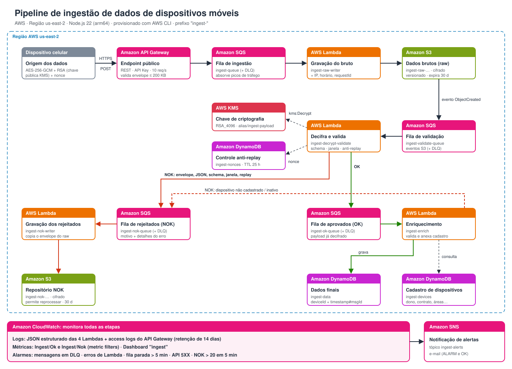

# Pipeline de ingestão de dados de dispositivos móveis

Pipeline serverless na AWS que recebe leituras de telemetria **criptografadas** enviadas por dispositivos (rastreadores/celulares), valida, enriquece com o cadastro do dispositivo e grava o resultado no DynamoDB. As mensagens rejeitadas vão para um repositório separado, que permite reprocessá-las.

- **Região:** us-east-2
- **Linguagem:** Node.js 22 (arm64), CommonJS, AWS SDK v3
- **Provisionamento:** scripts AWS CLI idempotentes (`infra/`)

## Arquitetura



> Também disponível em [PNG](docs/arquitetura-pipeline-ingestao.png) e [PDF](docs/arquitetura-pipeline-ingestao.pdf).

### Fluxo

1. O **dispositivo** cifra o JSON com AES-256-GCM e cifra a chave AES com a chave pública RSA do KMS. Envia o envelope via `HTTPS POST`.
2. O **API Gateway** exige API Key, aplica rate limit, valida o formato do envelope e o envia **direto para o SQS** (sem Lambda).
3. A **Lambda `raw-writer`** grava a mensagem bruta no **S3 raw**, junto com IP, horário de chegada e `requestId`.
4. O evento do S3 aciona, via SQS, a **Lambda `decrypt-validate`**, que:
   - decifra a chave com o **KMS** e o payload com AES-GCM;
   - valida o JSON Schema;
   - verifica a janela de tempo e o **nonce** (anti-replay, no DynamoDB).
5. **OK →** a **Lambda `enrich`** consulta o cadastro `ingest-devices` e grava em `ingest-data` o payload, um retrato do cadastro e os metadados.
6. **NOK →** a **Lambda `nok-writer`** grava no **S3 nok** o motivo da rejeição e o envelope original (ainda cifrado).
7. O **CloudWatch** monitora todas as etapas e o **SNS** envia os alertas por e-mail.

### Serviços

| Serviço | Recurso | Objetivo |
|---|---|---|
| API Gateway (REST) | `ingest-api` | Endpoint público, API Key, 10 req/s, validação do envelope |
| SQS | `ingest-queue`, `-validate-`, `-ok-`, `-nok-queue` (+ DLQs) | Desacoplar etapas, absorver picos, retry automático |
| Lambda | `ingest-raw-writer` | Gravar o dado bruto no S3 |
| Lambda | `ingest-decrypt-validate` | Decifrar, validar schema, anti-replay |
| Lambda | `ingest-enrich` | Enriquecer com o cadastro e gravar o dado final |
| Lambda | `ingest-nok-writer` | Gravar os rejeitados |
| S3 | `ingest-raw-<conta>`, `ingest-nok-<conta>` | Dados brutos e repositório NOK (cifrados, versionados, 30 dias) |
| KMS | `alias/ingest-payload` (RSA_4096) | Criptografia ponta a ponta do payload |
| DynamoDB | `ingest-data`, `ingest-devices`, `ingest-nonces` | Dados finais, cadastro, controle anti-replay (TTL) |
| CloudWatch | dashboard `ingest`, 5 alarmes, metric filters | Logs, métricas OK/NOK e alarmes |
| SNS | `ingest-alerts` | Notificação dos alarmes por e-mail |

## Contrato da API

`POST /ingest` com os headers `x-api-key` e `Content-Type: application/json`.

**Envelope** (todos os campos em base64):

```json
{ "v": 1, "ek": "<chave AES cifrada RSA-OAEP-SHA256>", "iv": "<12 bytes>", "tag": "<16 bytes GCM>", "ct": "<payload cifrado>" }
```

**Payload** (o conteúdo cifrado em `ct`):

```json
{
  "deviceId": "abc123",
  "timestamp": "2026-10-27T20:00:00Z",
  "type": "telemetry",
  "nonce": "aleatório-único-por-mensagem",
  "data": { "lat": -23.5, "lon": -46.6, "battery": 87, "Tamper": 1, "Motion": 0, "Impact": 0,
            "InternalMoisture": 1, "MetallicMaterial": 0, "Jamming": 0 }
}
```

- Obrigatórios: `deviceId`, `timestamp`, `type`, `nonce` (16–64 caracteres `[A-Za-z0-9_-]`).
- O `timestamp` é aceito até 24 h no passado e até 5 min no futuro.
- Campos não previstos no schema são rejeitados ([`schema.js`](src/decrypt-validate/schema.js)).

| HTTP | Significado |
|---|---|
| 200 | `{"messageId": "..."}`: aceito na fila |
| 400 | Envelope inválido ou `ct` com mais de 200 mil caracteres |
| 403 | API Key ausente ou inválida |
| 415 | `Content-Type` diferente de `application/json` |
| 429 | Rate limit: o app deve repetir com backoff exponencial |

O 200 confirma só o enfileiramento. A validação é assíncrona e os rejeitados ficam no S3 nok, com um destes motivos: `ek_invalida`, `falha_decifrar`, `json_invalido`, `schema_invalido`, `fora_da_janela`, `replay`, `dispositivo_nao_cadastrado` ou `dispositivo_inativo`.

[`tools/encrypt-envelope.js`](tools/encrypt-envelope.js) é a implementação de referência do lado do app.

## Estrutura

```
infra/   scripts AWS CLI por fase (01-fundacao … 07-observabilidade, teardown)
src/     código das Lambdas (um diretório por função)
test/    testes unitários (Jest, com mocks do SDK)
tools/   simulador do celular, seed do cadastro, teste ponta a ponta
docs/    plano, inventário de recursos, decisões e diagrama
```

## Uso

Pré-requisitos: Node.js 22, AWS CLI v2 autenticado (profile `aws-agent`).

```bash
npm install
source infra/config.sh

# Provisionar ou atualizar (idempotente; reexecutar republica o código das Lambdas)
./infra/01-fundacao.sh
./infra/02-entrada.sh
./infra/03-raw-writer.sh
./infra/04-decrypt-validate.sh
./infra/05-nok-writer.sh
./infra/06-enrich.sh
./infra/07-observabilidade.sh

# Cadastro de dispositivos
node tools/seed-devices.js [arquivo.json]     # padrão: tools/devices.example.json

# Enviar uma leitura como o celular
KEY=$(aws apigateway get-api-key --api-key <KEY_ID> --include-value --query value --output text)
node tools/encrypt-envelope.js '{"deviceId":"abc123","type":"telemetry","data":{"battery":80}}' \
  | curl -X POST -H "x-api-key: $KEY" -H 'Content-Type: application/json' --data-binary @- \
    https://<API_ID>.execute-api.us-east-2.amazonaws.com/dev/ingest
```

## Testes

```bash
npm test                          # unitários
npx jest -t 'replay'              # um caso específico
npm run e2e                       # 6 cenários contra o ambiente real
npm run e2e -- --load 200         # carga leve
```

Resultados de referência:
- 32 testes unitários e 6 cenários ponta a ponta, todos passando.
- Carga de 200 mensagens: 100% das aceitas foram gravadas; latência ponta a ponta p50 ≈ 10 s e p95 ≈ 35 s.

## Observabilidade

Os alarmes enviam e-mail via SNS:

| Alarme | Dispara quando |
|---|---|
| `ingest-dlq-mensagens` | Há mensagens em qualquer DLQ |
| `ingest-lambda-erros` | Alguma Lambda tem erro |
| `ingest-fila-parada` | A mensagem mais antiga da fila de entrada tem mais de 5 min |
| `ingest-api-5xx` | A API retorna erro 5XX |
| `ingest-nok-alto` | Há mais de 20 rejeições em 5 min |

Os logs das Lambdas são JSON estruturado e os access logs da API ficam em `/aws/apigateway/ingest-api`, com retenção de 14 dias.

## Custos e remoção

No plano Free, o custo é de aproximadamente **US$ 1/mês** (a chave KMS assimétrica); os demais serviços ficam dentro do free tier nesse volume.

Para remover tudo (apaga os dados; a chave KMS fica agendada para exclusão em 7 dias):

```bash
./infra/teardown.sh --confirm
```

## Documentação

- [Plano, inventário de recursos com IDs, decisões e lições](docs/2026-10-27-plano-pipeline-ingestao.md)
- [CLAUDE.md](CLAUDE.md): convenções de código e arquitetura para desenvolvimento assistido

### Próximos passos para produção

- Autenticação por dispositivo (HMAC ou Cognito); a API Key única serve só para controle de cota.
- PITR no `ingest-data` e chave KMS própria na fila OK.
- Infraestrutura como código (CDK/CloudFormation) e ambientes dev/prod separados.
- Reprocessamento automatizado do repositório NOK.
